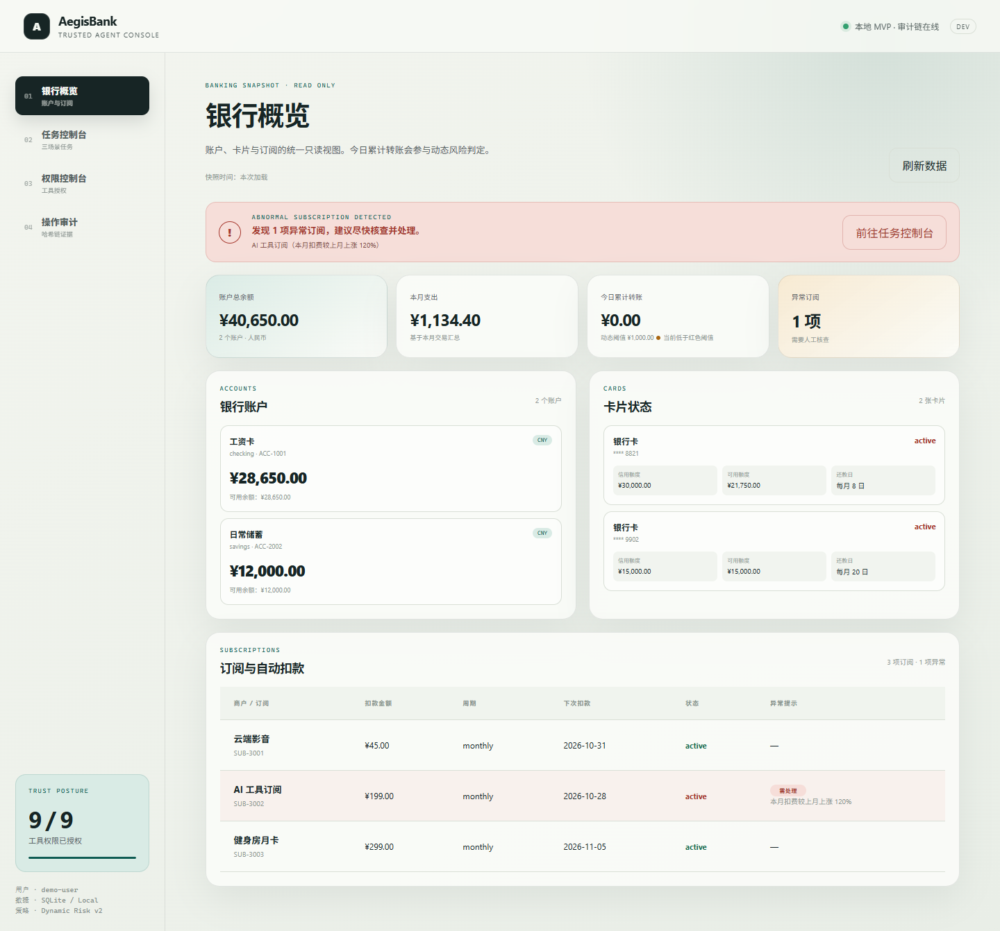
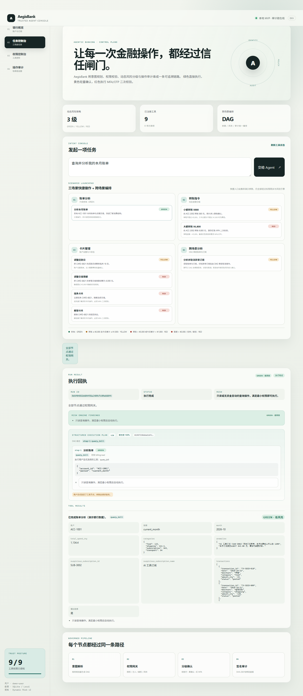
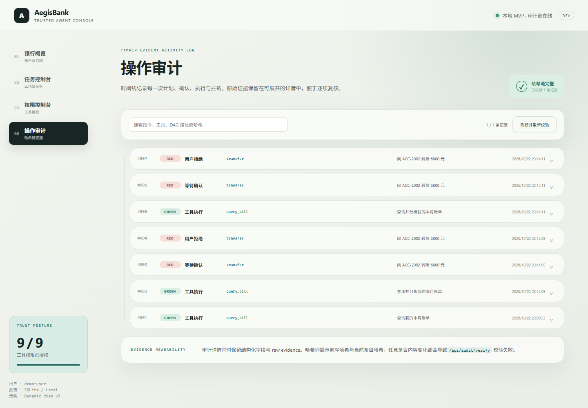

# AegisBank · 可信银行 AI 智能体

> 让每一次金融操作，都经过可解释的动态风险判断、最小权限和可验证的审计。

AegisBank 是一个面向银行场景的安全自治智能体原型：用户用自然语言发起账户、卡片、转账、理财或订阅任务，系统将意图编译为结构化 DAG 计划，在执行前经过动态风险引擎与统一权限网关，高风险动作进入确认/MFA 流程，执行过程和结果同步写入 SHA-256 审计哈希链。

> [!IMPORTANT]
> **本项目是本地可运行的演示原型。** 所有账户、卡片、账单、交易、订阅、理财与转账结果均来自确定性的 Mock Bank Core 模拟数据，不连接任何真实银行系统、支付网络或客户数据。演示 OTP 仅用于本地流程展示，不代表生产级身份认证或 MFA 能力；理财内容不构成任何投资建议。

## 产品定位

AegisBank 不是把大模型直接接上几个银行函数，而是为 Agent 增加一层可审计的「金融操作控制平面」：

```text
自然语言意图
  → 结构化 Planner（只生成计划，不执行工具）
  → 确定性 Plan Compiler（Schema / DAG / plan_hash 校验）
  → 动态风险引擎（绿 / 黄 / 红 + 可解释原因）
  → 统一权限网关（授权 / 越权 / 注入 / 分级决策）
  → 分级确认 + ActionEnvelope + 演示 MFA
  → Mock Bank Core 工具执行
  → 证据分层 + SHA-256 审计哈希链
```

它适合用作银行 Agent 原型的安全控制面参考实现、多工具 DAG 与人机确认的可运行 Demo，以及「Agent 如何被治理」的端到端样例；它**不**替代核心银行系统、真实风控决策引擎或生产身份认证系统。

## 界面预览

以下图片均来自本地运行中的真实控制台，存放于 `docs/screenshots/`。

### 银行概览



### 任务控制台



### 操作审计



更多真实界面：[确认/MFA 弹窗](docs/screenshots/confirmation-modal.png) · [权限控制台](docs/screenshots/permissions.png) · [银行概览移动端](docs/screenshots/banking-overview-mobile.png)。截图规范见 [docs/screenshots/README.md](docs/screenshots/README.md)。

## 核心能力

| 能力 | 说明 |
|---|---|
| **Mock Bank Core** | SQLite 驱动的确定性银行数据层，提供账户、卡片、交易、订阅与账单分析；所有余额、流水和订阅事实来自仓库，Planner 与 LLM 不能编造金融数据。 |
| **可插拔 Planner** | 规则 Planner 为默认与安全兜底；可配置 OpenAI-compatible LLM Planner；统一输出 `ExecutionPlan/v1`，不直接调用工具；模型输出经过字段白名单与冲突校验。 |
| **确定性 Plan Compiler** | 校验工具注册、参数 Schema、步骤 ID、依赖关系与环，完成拓扑排序并生成 `plan_hash`。 |
| **动态风险引擎** | 基于单笔金额、当日累计转账、产品风险等级、操作类型等确定性事实，输出绿/黄/红风险、评分与可解释原因；只能保持或上调工具基线风险。 |
| **统一权限网关** | 所有工具调用只有一条入口；按工具最小权限校验，拦截常见 Prompt 注入/越权指令，命中即整条请求拒绝；任一节点拒绝则整个 DAG 阻断。 |
| **ActionEnvelope 确认绑定** | 黄色/红色确认绑定计划哈希、参数哈希、风险等级、权限、一次性 nonce 与过期时间；执行前服务端重新校验，任一不一致返回 409。 |
| **幂等与状态机** | `Idempotency-Key` 防重复提交与重复扣款；任务状态机包含 `UNKNOWN / RECONCILED / ROLLED_BACK`，结果未知不会自动重试，需人工对账。 |
| **Readiness fail-closed** | `GET /api/health/ready` 检查 SQLite、审计链、Mock 种子与 Planner；未就绪时写操作返回 503，前端禁用写操作。 |
| **证据分层与审计链** | 工具结果（Mock 数据）、人工确认、策略判断、审计链四类证据随操作写入审计，SHA-256 哈希链可通过 API 校验。 |
| **六场景覆盖 6/6** | 转账（联系人/AA/定时）、账单（月报/年报/异常）、理财（产品/持仓/申购/赎回）、卡片（虚拟卡/密码/限额）、订阅（扣费识别/续费提醒）、跨场景联动（账单→取消订阅、生日 4 步 DAG）。 |
| **可插拔场景模块** | `scenarios/` 下每个模块自带 schema、种子、工具、意图、风险规则与只读路由，自动发现装配，新增场景不改核心。 |
| **React 控制台** | 银行概览、六场景面板、任务控制台、权限控制台、操作审计五个页面，展示计划、风险原因、确认状态、就绪状态与审计证据。 |

## 六场景闭环

### 场景一：智能转账（含联系人、AA、定时）

示例指令：

```text
向 ACC-2002 转账 880 元
给妈妈转 500 元
这顿 300 元 4 个人 AA
明天给张三转 300 元
```

- 按账户 ID 转账：单笔 880 元通常为黄色；同日再转 500 元使累计超过 1000 元后升级红色强验证；
- 人名/别名/手机号转账：联系人唯一命中才执行，多命中或未命中一律澄清，**不猜测收款人**；
- AA 拆分：总额 ÷ 人数，为参与者生成可并行的多步 DAG，风险按 AA 总额与日累计判定；
- 定时转账：创建 `scheduled_tasks` 任务（一次/每月/每年），到期由 `run_due_tasks` 执行，重复调用不会重复扣款。

### 场景二：账单分析

示例指令：

```text
分析我的本月账单
去年的年度账单
识别我的订阅扣费
这个月有哪些续费
```

返回：月度/年度报告（分类汇总、Top 商户、环比、异常说明）、异常检测（重复扣费、超预算、订阅金额突增、非活跃时段交易）、订阅扣费识别与续费提醒。当前 Mock 数据中 `SUB-3002`（AI 工具订阅）带「本月扣费较上月上涨 120%」风险标记。

### 场景三：理财操作（模拟数据）

示例指令：

```text
有哪些理财产品
买 1000 元稳健短债A
赎回 500 元
```

- 5 个模拟产品（R1–R5），展示类型、风险等级、起购金额、预期年化与期限；
- 风险测评记录 R1–R5 风险偏好；
- 申购始终为红色（资金投入 + 强验证）；赎回 ≤ 1000 元为黄色、> 1000 元为红色；
- 全部为模拟产品与模拟收益，不构成任何投资建议，不产生真实资金变动。

### 场景四：卡片管理

支持的示例指令：

```text
把还款日调整到每月 18 日
把信用卡额度调整到 8000 元
把 CARD-8821 的单日交易限额设置为 3000 元
挂失卡片 CARD-9902
申请一张虚拟卡，额度 3000 元
把 CARD-8821 的密码重置
解锁 CARD-8821 的交易限额
```

- 还款日/交易限额调整、虚拟卡申请与发卡：黄色确认；
- 额度调整、指定限额解锁超过 5000 元：红色强验证；
- 挂失/解挂、密码重置：红色强验证（演示 OTP）；密码不接收明文，只记录修改时间。

### 场景五：订阅/代扣

示例指令：

```text
查看我的订阅
取消异常订阅
识别我的订阅扣费
这个月有哪些续费
```

- 订阅查询与风险标记为绿色；
- 取消订阅为黄色确认；
- 扣费识别与续费提醒为绿色只读查询，基于流水与订阅周期生成站内提醒，不含外部推送。

### 场景六：跨场景联动

**DAG 一：账单分析 → 取消异常订阅**

```text
分析我的账单并取消异常订阅
```

```text
step-1: query_bill
   │  data.suspicious_subscription_id
   ▼
step-2: cancel_subscription
```

步骤 2 使用前序结果引用 `${steps.step-1.data.suspicious_subscription_id}`，确保取消的是本次分析实际发现的异常订阅。

**DAG 二：生日准备（4 步）**

```text
帮我准备下个月妈妈的生日，预算 1000 元
```

```text
step-1: query_contact_birthday   （读联系人簿生日）      绿
step-2: lock_budget_funds        （锁定预算，可补偿解锁） 黄
step-3: schedule_flower_order                           黄
step-4: schedule_cake_order                             黄
```

礼物在生日前 2 天由 `run_due_tasks` 触发（演示可用「时间快进」接口），取消流程可用 `unlock_budget_funds` 退回锁定金额。

## 动态风险分级

风险引擎位于工具基线与权限网关之间。工具 Manifest 声明基线风险，`DynamicRiskEngine` 只能保持或上调，不会因为模型输出而降低风险。

| 操作 / 条件 | 风险等级 | 系统行为 |
|---|---|---|
| 账单分析、订阅查询、理财查询、联系人查询 | 🟢 绿色 | 最小权限满足后自动执行 |
| 单笔转账且当日累计不超过 1000 元 | 🟡 黄色 | 创建待确认动作，用户确认后执行 |
| 单笔转账超过 5000 元，或当日累计将超过 1000 元 | 🔴 红色 | 确认 + 演示 OTP 强验证 |
| 调整还款日、设置交易限额、取消订阅、虚拟卡申请/发卡 | 🟡 黄色 | 一次用户确认 |
| 调整卡片额度不超过 5000 元 | 🟡 黄色 | 一次用户确认 |
| 调整卡片额度超过 5000 元、限额解锁目标超过 5000 元、卡片挂失/解挂/密码重置 | 🔴 红色 | 确认 + 演示 OTP |
| 理财申购 | 🔴 红色 | 确认 + 演示 OTP |
| 理财赎回 ≤ 1000 元 / > 1000 元 | 🟡 / 🔴 | 确认 / 确认 + 演示 OTP |
| 定时转账单笔 > 5000 元 | 🔴 红色 | 确认 + 演示 OTP |
| 预算锁定、生日礼物预订 | 🟡 黄色 | 一次用户确认 |
| 取消定时任务、解锁预算资金 | 🟢 绿色 | 直接执行（补偿/取消） |

风险结果会同时出现在：Agent 响应的 `risk` 与 `evidence`、计划步骤的 `risk_level / risk_reasons`、待确认动作与审计记录、前端风险徽标。

> 动态风险使用确定性演示规则，不是信用评分、反欺诈模型或生产风控决策。LLM 只负责生成结构化计划，风险判断不信任 LLM 输出。

## 架构

```text
┌─────────────────────────────────────────────────────────────┐
│ React 19 + TypeScript + Vite 控制台                          │
│ 银行概览 │ 六场景面板 │ 任务控制台 │ 权限控制台 │ 操作审计      │
└────────────────────────────┬────────────────────────────────┘
                             │ /api（readiness 未就绪时禁用写操作）
┌────────────────────────────▼────────────────────────────────┐
│ FastAPI + Pydantic                                          │
│                                                             │
│  Planner（rule / OpenAI-compatible LLM / auto fallback）     │
│      │ ExecutionPlan/v1                                     │
│      ▼                                                      │
│  Plan Compiler ── Schema / 工具注册 / DAG / plan_hash         │
│      │                                                      │
│      ▼                                                      │
│  DagScheduler ── 注入拒绝 / 幂等 / 熔断 / 依赖排序            │
│      │                                                      │
│      ├── DynamicRiskEngine ── 金额 / 累计 / 产品 / 操作类型   │
│      ├── PermissionGateway ── 最小权限 / 注入拦截 / 决策      │
│      └── Trust ── ActionEnvelope / 状态机 / 证据 / readiness  │
│      │                                                      │
│      ▼                                                      │
│  34 个银行工具（核心 9 + 场景 25）                             │
│      │      scenario 模块：wealth / transfers / bills /      │
│      │                     cards / automation（自动发现）     │
│      ▼                                                      │
│  BankingRepository（SQLite Mock Bank Core）                  │
│      │                                                      │
│      ▼                                                      │
│  AuditService ── 证据分层 + SHA-256 哈希链 / 完整性校验        │
└─────────────────────────────────────────────────────────────┘
```

完整模块边界、数据流与计划契约见 [架构说明](docs/ARCHITECTURE.md)、[银行领域模型与六场景闭环](docs/BANKING-DOMAIN.md) 和 [完整架构图 PNG](docs/architecture/aegisbank-architecture.png)。

### 工具目录

核心工具 9 个：

| 工具 | 权限 | 基线风险 | 作用 |
|---|---|---|---|
| `query_bill` | `billing:read` | 绿色 | 账单分析、分类与异常订阅识别 |
| `transfer` | `transfer:execute` | 黄色 | 智能转账，按金额与日累计动态升级 |
| `adjust_repayment_date` | `card:manage` | 黄色 | 修改信用卡还款日 |
| `adjust_card_limit` | `card:manage` | 黄色 | 调整卡片额度，超过阈值升级红色 |
| `set_transaction_limit` | `card:manage` | 黄色 | 设置单日交易限额 |
| `report_card_lost` | `card:security` | 红色 | 卡片挂失 |
| `unlock_card` | `card:security` | 红色 | 卡片解挂 |
| `list_subscriptions` | `subscription:read` | 绿色 | 查询订阅与风险标记 |
| `cancel_subscription` | `subscription:manage` | 黄色 | 取消指定订阅 |

场景工具 25 个（理财 5、转账 3、账单 4、卡片 4、自动化 9），完整清单与风险规则见 [BANKING-DOMAIN.md](docs/BANKING-DOMAIN.md) §3。

### 关键 API

```text
GET  /api/banking/overview          银行概览：账户、卡片、订阅与异常提示
GET  /api/tools                     工具目录与当前授权状态（34 个工具）
GET  /api/planner/info              Planner 模式、工具与计划契约
POST /api/planner/plan              仅预览结构化计划，不执行工具
POST /api/agent/run                 规划、风险评估、网关校验并执行（支持 Idempotency-Key）
POST /api/confirmations/{action_id}        确认/拒绝待执行动作，红色动作校验演示 OTP（支持 Idempotency-Key）
GET  /api/permissions               权限列表
PUT  /api/permissions/{tool_name}   授予或撤回工具权限
GET  /api/audit                     查看审计记录（含证据分层）
GET  /api/audit/verify              校验 SHA-256 审计哈希链
GET  /api/health/ready              就绪检查（sqlite / audit_chain / mock_bank_seed / planner）
GET  /api/trust/actions/{action_id}        查询任务状态机历史与掩码 envelope
POST /api/trust/actions/{action_id}/reconcile  UNKNOWN 人工对账（reconciled / rolled_back）
GET  /api/trust/circuit-breaker     熔断状态
POST /api/trust/circuit-breaker/reset  重置熔断
GET  /api/wealth/products|holdings|orders
GET  /api/contacts
GET  /api/bills/report | /api/bills/anomalies
GET  /api/subscriptions/charges | /api/subscriptions/reminders
GET  /api/cards/applications
GET  /api/automation/schedules|goals|orders
POST /api/automation/run-due        演示时间快进：执行到期定时任务
```

## 技术栈

| 层 | 选型 | 说明 |
|---|---|---|
| 后端 | Python 3.11+ · FastAPI · Pydantic | API、工具 SDK、动态风险、权限网关、信任层与 DAG 调度 |
| Planner | Rule + OpenAI-compatible LLM | 结构化 `ExecutionPlan/v1`，可插拔、可回退、可校验 |
| 持久化 | SQLite（stdlib） | 本地零依赖；保存 Mock Bank Core、授权、待确认动作、信任状态与审计链 |
| 前端 | React 19 · TypeScript · Vite | 银行概览、六场景面板、任务控制台、权限控制台、操作审计 |
| 测试 | pytest · httpx · Vitest | 后端 85 项、前端 14 项 |

## 快速开始

前置条件：

- Python 3.11+、`uv`
- Node.js 20.19+（或 22.12+）、`pnpm`
- Linux / WSL Ubuntu 24.04 环境

```bash
# 进入项目根目录
cd /path/to/aegisbank

# 安装 Python / Node 依赖
bash scripts/bootstrap.sh

# 同时启动后端 API 与前端
bash scripts/dev.sh
```

打开：

- 前端控制台：<http://127.0.0.1:5173>
- API 文档：<http://127.0.0.1:8000/docs>
- 健康检查：<http://127.0.0.1:8000/api/health>
- 就绪检查：<http://127.0.0.1:8000/api/health/ready>

也可以分别启动：

```bash
# 终端 1：后端
cd backend
uv run uvicorn aegisbank_api.main:app --reload --host 0.0.0.0 --port 8000

# 终端 2：前端
cd frontend
pnpm dev
```

可选配置（复制根目录 `.env.example` 到 `backend/.env`）：

```bash
AEGIS_DATABASE_PATH=data/aegisbank.db
AEGIS_DEMO_OTP=246810
AEGIS_CONFIRMATION_TTL_SECONDS=300
AEGIS_CORS_ORIGINS=http://localhost:5173,http://127.0.0.1:5173
AEGIS_PLANNER_MODE=rule   # rule | llm | auto
AEGIS_LLM_BASE_URL=
AEGIS_LLM_API_KEY=
AEGIS_LLM_MODEL=
AEGIS_AUTOMATION_ENABLED=false      # 可选后台轮询定时任务
AEGIS_AUTOMATION_INTERVAL_SECONDS=30
AEGIS_CIRCUIT_BREAKER_THRESHOLD=3
AEGIS_CIRCUIT_BREAKER_WINDOW_SECONDS=60
AEGIS_CIRCUIT_BREAKER_LOCK_SECONDS=60
```

`rule` 模式完全本地、无模型依赖；`auto` 模式优先调用 LLM，不可用时自动回退到规则 Planner。

## 测试与工程命令

```bash
bash scripts/lint.sh    # 后端 ruff + 前端 TypeScript 类型检查
bash scripts/build.sh   # 后端 compileall + 前端 Vite 生产构建
bash scripts/test.sh    # pytest（85 项）+ Vitest（14 项）
bash scripts/smoke.sh   # 启动 API，跑一条绿色链路并校验审计链
```

后端测试覆盖：工具注册与权限种子、绿色自动执行、黄色确认、红色 OTP、转账金额与日累计风险升级、账单分析与跨场景 DAG、卡片额度升级、撤权拦截、待确认期间撤权复检、Prompt 注入拦截、计划 Schema/DAG 校验、LLM 输出解析与自动回退、审计链完整性；阶段 1 新增 ActionEnvelope 篡改/过期/nonce 复用、幂等、UNKNOWN 与对账、readiness fail-closed、证据分层、模型候选白名单、熔断；2B 新增理财、联系人/AA、账单报告/异常/订阅、虚拟卡/密码/限额、定时任务/生日 DAG/时间快进等场景测试。

## 演示路径

建议按以下顺序体验 Demo：

1. 打开银行概览，查看账户、卡片、订阅和异常标记；顶部就绪横幅显示四个组件 OK；
2. 任务控制台执行「分析我的本月账单」，观察分类与异常订阅；
3. 执行「分析我的账单并取消异常订阅」，查看两步 DAG 和变量解析结果；
4. 执行「向 ACC-2002 转账 880 元」完成黄色确认；同日再转 500 元，观察累计风险升级为红色并输入演示 OTP `246810`；
5. 六场景面板：查看理财产品并执行「买 1000 元稳健短债A」（红色 + OTP）；执行「给妈妈转 500 元」；
6. 执行「这顿 300 元 4 个人 AA」，观察并行转账 DAG；
7. 执行「分析我的本月账单」或「去年的年度账单」查看月报/年报与异常；
8. 执行「帮我准备下个月妈妈的生日，预算 1000 元」，观察 4 步跨场景 DAG（查生日 → 锁预算 → 鲜花/蛋糕）；
9. 在六场景面板点击「时间快进」（`POST /api/automation/run-due`），观察到期任务执行与审计 `trigger_source=scheduled`；
10. 权限控制台撤回某工具权限，再次执行应被网关阻断；
11. 操作审计页校验 SHA-256 哈希链，展开记录查看证据分层；在任务控制台查看 `UNKNOWN` 与对账入口。

## 路线图

| 阶段 | 内容 | 状态 |
|---|---|---|
| 0 | 产品边界与仓库定型 | ✅ 已完成 |
| 1 | 信任工程（ActionEnvelope / 幂等 / 状态机 / readiness / 证据分层 / 注入整条拒绝 / 模型白名单 / 熔断骨架） | ✅ 已完成 |
| 2A | 比赛硬要求（回退补偿、可疑行为熔断、沙箱、MFA Provider、IM、多角色） | 计划中（下一步） |
| 2B | 六场景完整覆盖 | ✅ 已完成（6/6） |
| 2.5 | 人工用户体验（开发者 Dogfooding） | 计划中 |
| 3 | PPT、视频、安全自评和最终交付 | 计划中 |

阶段 2A 的详细清单、阶段 2B 的产物与当前验证基线见 [产品路线图](docs/ROADMAP.md) 与 [总规划](docs/MASTER-PLAN.md) §7/§8。

## 目录结构

```text
aegisbank/
├─ backend/
│  ├─ aegisbank_api/
│  │  ├─ banking/          # Mock Bank Core 领域模型与 SQLite 仓库
│  │  ├─ planning/         # Planner 契约、规则/LLM 实现、Compiler、意图规则
│  │  ├─ trust/            # ActionEnvelope、幂等、状态机、证据、readiness、熔断
│  │  ├─ scenarios/        # 5 个自动发现场景模块（25 个工具）与模块契约
│  │  ├─ tools/finance.py  # 9 个核心银行工具与 Manifest
│  │  ├─ risk.py           # 动态风险引擎与可解释原因
│  │  ├─ gateway.py        # 统一权限网关、注入拦截、分级决策
│  │  ├─ scheduler.py      # DAG 调度、变量解析、确认恢复、信任层接线
│  │  ├─ audit.py          # 证据分层 + SHA-256 审计哈希链
│  │  ├─ db.py             # SQLite 表与事务（信任层持久化）
│  │  └─ main.py           # FastAPI 入口与 API 路由
│  └─ tests/               # API 闭环、Planner、信任层与六场景测试（9 个文件）
├─ frontend/
│  └─ src/                 # React 控制台（5 页）、API 客户端、风险展示与测试
├─ docs/
│  ├─ screenshots/         # 真实运行截图
│  ├─ architecture/        # 架构图 PNG / SVG / Mermaid
│  ├─ MASTER-PLAN.md       # 总规划与阶段设计
│  ├─ ROADMAP.md           # 路线图
│  ├─ ARCHITECTURE.md      # 模块边界、信任层与扩展契约
│  ├─ BANKING-DOMAIN.md    # 数据模型、34 个工具与六场景闭环
│  ├─ SECURITY.md          # 安全边界与信任层实现
│  └─ TECH-STACK.md        # 开发工具与技术栈
├─ scripts/                # bootstrap / dev / lint / build / test / smoke
├─ LICENSE                 # MIT License
├─ CONTRIBUTING.md         # 贡献指南
└─ README.md
```

## 文档索引

- [项目总规划（Master Plan）](docs/MASTER-PLAN.md)
- [银行领域模型与六场景闭环](docs/BANKING-DOMAIN.md)
- [架构说明（含信任层与场景扩展契约）](docs/ARCHITECTURE.md)
- [完整架构图](docs/architecture/aegisbank-architecture.png)
- [安全边界、信任层实现与生产化清单](docs/SECURITY.md)
- [开发工具与技术栈](docs/TECH-STACK.md)
- [开发环境与验收记录](docs/DEVELOPMENT-ENVIRONMENT.md)
- [产品路线图](docs/ROADMAP.md)
- [人工用户体验（Dogfooding）](docs/UX-DOGFOODING.md)
- [上游设计参考说明](docs/UPSTREAM-NOTES.md)
- [单文件产品介绍页](docs/product-overview.html)
- [产品介绍页渲染图](docs/screenshots/product-overview.png)
- [真实截图目录](docs/screenshots/README.md)

## 已知边界

AegisBank 是**安全自治 Agent 的可运行原型**，以下边界是刻意保留的：

- **模拟银行数据**：所有账户、卡片、交易、账单、订阅、理财、余额与转账结果均为 Mock Bank Core 数据，不连接真实银行接口，不产生真实资金变动；理财内容不构成投资建议；
- **固定演示用户**：使用 `demo-user`，未接入登录、会话、设备指纹或真实身份认证；
- **演示 OTP / MFA**：默认验证码 `246810` 与演示确认令牌仅用于本地演示，不是生产 MFA；
- **演示风险规则**：动态风险引擎是确定性规则，不是生产反欺诈/信用决策模型；
- **六场景已覆盖 6/6**：但其中步骤级暂停/回退/补偿、可疑行为熔断策略、工具沙箱、IM 渠道、多角色撤权仍属于阶段 2A；
- **时间维度为演示实现**：`scheduled_tasks` + `POST /api/automation/run-due` 时间快进 + 可选后台轮询，不是真实常驻 cron，也未实现跨进程分布式调度；
- **单机持久化**：SQLite 适合本地原型，不满足银行级高可用、隔离、容灾和 WORM 审计要求；幂等键与 nonce 无 TTL 清理；
- **有限安全防护**：注入检测、权限网关、ActionEnvelope、幂等与哈希链是基线，不替代专门的安全策略引擎、沙箱、限流、CSRF/mTLS 与渗透测试；
- **LLM 可选**：规则 Planner 无模型依赖；接入 OpenAI-compatible 模型时仍需经过同一 Compiler、候选白名单、风险引擎和权限网关。

这些边界被隔离在 Mock Bank Core、Planner、Risk、Gateway、Trust、Audit 等模块中，后续可替换为银行级实现而不改变 Agent 主流程。

## License

本项目采用 [MIT License](LICENSE)。

Copyright (c) 2026 LQZ5885
