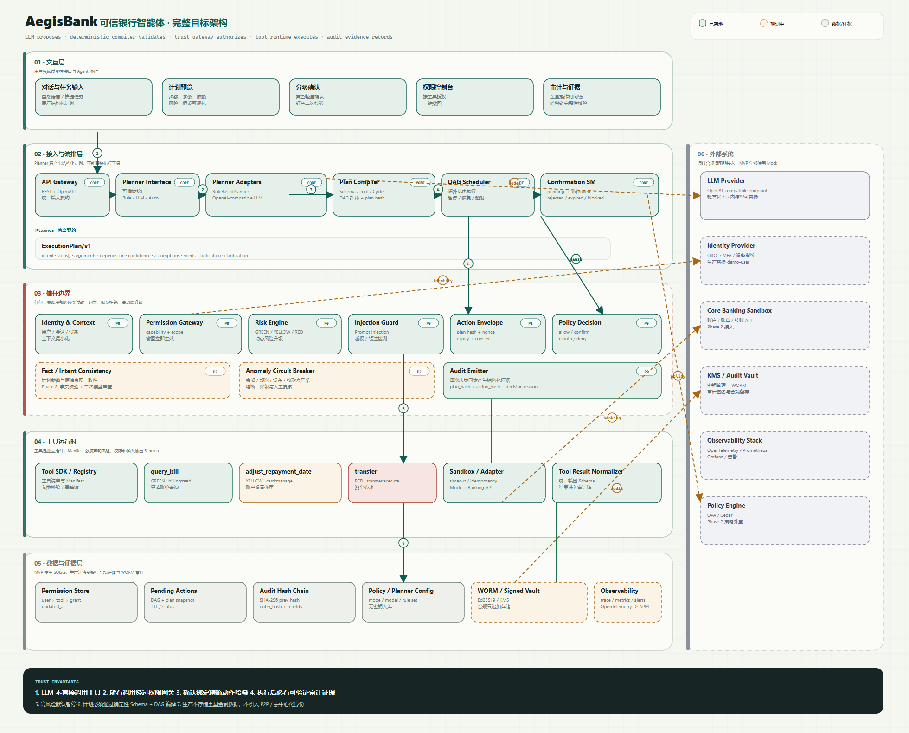

# AegisBank · 银行 AI 智能体

> 说一句话就能办业务，而且每一笔都说得清、拦得住、查得到。

**AegisBank** 是面向银行场景的可信 AI 智能体（AI Banking Agent），2026 深圳国际金融科技大赛人工智能赛道参赛作品，由 0xChainAegis 团队开发。用户用自然语言描述金融需求，Agent 自主理解意图、规划任务链路，并在严格的分级权限与安全框架内完成银行业务操作。

它要证明的不是「能调用银行函数」，而是：**一笔金融操作从自然语言意图到真正执行，全程可解释、可拦截、可追溯；用户确认的就是实际执行的那一笔，失败与未知状态不会被伪装成成功。**

[作品简介](#作品简介) · [赛题对应](#赛题对应) · [它是如何工作的](#它是如何工作的) · [安全设计](#安全设计) · [系统架构](#系统架构) · [快速开始](#快速开始) · [参赛材料](#参赛材料)


## 作品简介

> AegisBank 是面向银行场景的可信 AI 智能体原型，以自然语言生成结构化任务计划，结合有界语义解析、DAG 编译、动态风险分级、人工确认与演示 MFA，覆盖转账、账单、理财、卡片、订阅和跨场景联动。系统通过统一权限网关、执行守卫、幂等及审计哈希链控制操作，支持转账补槽、金额修订与本人历史回读。全部金融数据来自确定性模拟银行，不连接真实银行或产生真实资金变动。

## 赛题对应

赛题要求构建银行 AI 智能体，至少覆盖 3 个核心场景并鼓励全覆盖。AegisBank 已完成六个参考场景 **6/6**：

| 场景 | 已实现能力 |
|---|---|
| **智能转账** | 按账户、联系人姓名 / 别名 / 手机号转账；AA 拆分生成可并行的多步 DAG；一次、每月、每年定时转账；人名多命中或未命中一律澄清，不猜测收款人 |
| **账单分析** | 月度 / 年度报告、分类汇总、Top 商户与环比；重复扣费、超预算、订阅涨价、非活跃时段等异常识别 |
| **理财操作** | 模拟产品（R1–R5）、持仓与风险测评、申购与赎回；申购恒为红色强验证，赎回按金额分级 |
| **卡片管理** | 额度、还款日、单日交易限额调整；挂失 / 解挂；虚拟卡申请与发卡；密码重置（不接收明文）；限额解锁 |
| **订阅 / 代扣** | 订阅查询与风险标记、扣费识别、续费提醒；确认后取消订阅 |
| **跨场景联动** | 「分析账单并取消异常订阅」两级 DAG；「准备妈妈生日」查生日 → 锁预算 → 订鲜花 / 蛋糕 4 步 DAG |

可直接在控制台尝试的指令：

```text
分析我的本月账单
向 ACC-2002 转账 880 元
给妈妈转 500 元
这顿 300 元 4 个人 AA
买 1000 元稳健短债A
解挂卡片 CARD-8821
分析我的账单并取消异常订阅
帮我准备妈妈的生日，预算 1000 元
```

### 权限分级：低风险自动、高风险确认、极高风险强验证

| 级别 | 执行策略 | 本作品中的典型操作 |
|---|---|---|
| 🟢 绿色 | 最小权限满足后自动执行 | 余额、账单、持仓、订阅查询、续费提醒、账单异常检测 |
| 🟡 黄色 | 展示计划、参数与风险原因，用户明确确认后执行 | 小额转账（当日累计 ≤ 1000 元）、取消订阅、虚拟卡申请、还款日 / 限额调整、预算锁定 |
| 🔴 红色 | 确认 + 演示 MFA（OTP 或模拟生物识别） | 大额或累计升级转账、理财申购、挂失 / 解挂、密码重置、额度大幅调整 |

- 动态风险由确定性规则计算：单笔金额、当日累计、产品风险等级、操作类型等事实共同决定等级、评分与可解释原因；
- 模型输出只能保持或上调工具基线风险，不能降低风险等级，也不能替代权限判断；
- 黄色 / 红色确认绑定 `ActionEnvelope`（计划哈希、参数哈希、风险、权限、一次性 nonce、有效期）；执行前服务端重新校验，任一不一致返回 `409` 且不执行。

### 安全机制：幻觉防护、注入防御、操作审计、异常熔断、沙箱

| 赛题要求 | AegisBank 的实现 |
|---|---|
| **幻觉防护** | 全部金融事实来自确定性 Mock Bank Core；Planner 只生成候选计划，模型输出经字段白名单、未注册工具拒绝与参数冲突校验；查询无记录时如实返回「无记录」，不编造 |
| **注入防御** | 指令与参数在规划前扫描，命中 Prompt 注入 / 越权指令即整条请求拒绝，不生成计划、不写业务状态 |
| **操作审计** | 记录触发时间、原始指令、DAG 路径、工具入参、执行结果、确认状态与分层证据；SHA-256 哈希链支持完整性校验 |
| **异常熔断** | 连续失败、短时多次红色操作、注入命中累计三类规则共享熔断状态；触发后写操作 fail closed，仅 operator 可在审计留痕下解锁 |
| **沙箱环境** | 所有工具统一经 `ToolExecutor` + `ExecutionGuard` 执行；限制超时、网络访问、入参 / 出参体积与工具白名单，违规先写审计再拒绝 |

### 意图理解与任务规划

- **有界语义解析**：`SemanticFrame/v1` 统一处理金额（中文数字、千分位、千 / 万单位）、联系人、账户、卡片与日期，保留原文和槽位证据；
- **模糊与省略上下文**：支持「给妈妈转钱 → 五百 → 不是500，改成300」这类受控多轮补槽与金额修订；修订会重新编译计划、更新计划哈希、重新评级并生成新确认，旧确认执行返回 `409`；
- **复杂任务 DAG**：Planner 输出结构化计划，Plan Compiler 完成工具与参数 Schema 校验、依赖校验、环检测与拓扑排序，并生成 `plan_hash`；
- **不猜参数**：高风险参数缺失，或条件、组合请求超出支持范围时返回澄清，而不是编造或只执行其中一部分；
- **中断、回退与人工接管**：支持节点间暂停 / 恢复、人工回退与逆序补偿；不可逆步骤阻止自动回滚并转人工对账；结果未知时进入 `UNKNOWN`，禁止自动重试；
- **多渠道接入**：Web 控制台与 IM / CLI / webhook 复用同一 Planner、风险引擎、权限网关、MFA 与审计链，消息级幂等防止重复执行。

## 它是如何工作的

```text
自然语言输入
  → 注入扫描
  → Planner（规则 / LLM / 自动回退，只生成候选计划）
  → Plan Compiler（Schema / 工具注册 / DAG / plan_hash）
  → 动态风险引擎（绿 / 黄 / 红 + 可解释原因）
  → 统一权限网关（最小权限 / 角色能力 / 分级决策）
  → 分级确认 + ActionEnvelope + 演示 MFA
  → ToolExecutor + ExecutionGuard（沙箱 / 超时 / 网络 / 体积）
  → Mock Bank Core 执行
  → 证据分层 + SHA-256 审计哈希链
```

以「分析我的账单并取消异常订阅」为例，系统生成两步 DAG：`query_bill` 的结果通过 `${steps.step-1.data.suspicious_subscription_id}` 传给 `cancel_subscription`，保证取消的是本次分析实际发现的异常订阅。任务包含状态变更，因此整条计划先等待确认，确认后再依次执行。

再以「帮我准备妈妈的生日，预算 1000 元」为例：查联系人生日（绿）→ 锁定预算（黄，可补偿解锁）→ 预约鲜花（黄）→ 预约蛋糕（黄），四步跨场景 DAG 由统一定时任务在生日前触发。

## 界面预览

| 任务控制台 | 操作审计 |
|---|---|
|  |  |

更多真实界面：[银行概览](docs/screenshots/banking-overview.png) · [确认 / 演示 MFA](docs/screenshots/confirmation-modal.png) · [刷新后恢复待确认任务](docs/screenshots/confirmation-recovery-2026-10-25.jpg) · [工具权限](docs/screenshots/permissions.png) · [移动端概览](docs/screenshots/banking-overview-mobile.png)。

## 安全设计

AegisBank 把「模型能力」和「金融执行权」分开：模型只生成候选计划，权限、风险、执行与审计全部由确定性代码控制。

| 机制 | 说明 |
|---|---|
| **统一权限网关** | 所有工具调用只有一条入口；按工具最小权限、角色能力与注入风险决策；任一节点被拒绝则整条 DAG 阻断 |
| **ActionEnvelope** | 确认与执行强绑定；一次性 nonce、过期时间、计划与参数哈希，重放与篡改均被拒绝 |
| **幂等与状态机** | `Idempotency-Key` 防止重复提交与重复扣款；状态机覆盖 `UNKNOWN / RECONCILED / ROLLED_BACK`，结果未知不自动重试 |
| **暂停 / 回退 / 补偿** | 节点间暂停不重复已执行步骤；失败按相反顺序补偿，补偿前重新经过网关复检；不可逆步骤转人工对账 |
| **Readiness fail-closed** | `GET /api/health/ready` 检查 SQLite、审计链、Mock 种子与 Planner；未就绪时写操作返回 `503`，前端禁用写操作 |
| **证据分层与审计链** | 工具结果、人工确认、策略决策、哈希链四类证据随操作写入；`GET /api/audit/verify` 校验哈希链完整性 |
| **可插拔 MFA** | OTP 与模拟生物识别两种 Provider，按风险等级与敏感工具选择；审计记录验证方式与结果 |
| **多角色与撤权** | `user / operator / auditor` 能力矩阵；operator 可解锁熔断与紧急撤权，auditor 只读；撤权立即阻断并留痕 |
| **场景模块自动发现** | `scenarios/` 下每个模块自带 schema、种子、工具、意图与风险规则，新增场景不修改核心装配 |

## 系统架构



```text
┌──────────────────────────────────────────────────────────────┐
│ React 19 + TypeScript 控制台                                  │
│ 银行概览 │ 六场景 │ 任务控制台 │ 权限 │ 审计 │ 能力 │ 运维      │
└─────────────────────────────┬────────────────────────────────┘
                              │ /api（未就绪时禁用写操作）
┌─────────────────────────────▼────────────────────────────────┐
│ FastAPI + Pydantic                                           │
│  Planner → Plan Compiler → DAG Scheduler                     │
│      ├── 动态风险引擎（金额 / 累计 / 产品 / 操作类型）          │
│      ├── 统一权限网关（最小权限 / 注入拦截 / 角色能力）         │
│      └── 信任层（Envelope / 状态机 / 证据 / readiness / MFA）   │
│                                                              │
│  ToolExecutor + ExecutionGuard（超时 / 网络 / 体积 / 白名单）   │
│      │                                                       │
│      ▼                                                       │
│  51 个银行工具（核心 10 + 场景 27 + 安全扩展 14）              │
│      ├─ scenarios：wealth / transfers / bills / cards /      │
│      │              automation（自动发现）                    │
│      ├─ extensions：compensation / authz / breaker /         │
│      │              mfa / sandbox / im                       │
│      └─ channels：IM / CLI / webhook 复用同一链路            │
│      │                                                       │
│      ▼                                                       │
│  BankingRepository（SQLite Mock Bank Core）                  │
│      │                                                       │
│      ▼                                                       │
│  AuditService ── 证据分层 + SHA-256 哈希链 / 完整性校验        │
└──────────────────────────────────────────────────────────────┘
```

完整模块边界、计划契约与扩展方式见[架构说明](docs/ARCHITECTURE.md)，银行数据模型与工具清单见[银行领域模型](docs/BANKING-DOMAIN.md)，安全边界与生产化清单见[安全说明](docs/SECURITY.md)。

## 技术栈

| 层 | 选型 | 说明 |
|---|---|---|
| 后端 | Python 3.11+（开发环境 3.12）· FastAPI · Pydantic v2 | API、工具 SDK、风险引擎、权限网关、信任层与 DAG 调度 |
| Planner | 规则 Planner + OpenAI-compatible LLM Planner | 默认离线规则规划；可配置模型规划，统一输出 `ExecutionPlan/v1` 并经过白名单与冲突校验 |
| 持久化 | SQLite（stdlib） | 本地零依赖；保存 Mock Bank Core、授权、待确认动作、信任状态与审计链 |
| 前端 | React 19 · TypeScript · Vite | 七页控制台：银行概览、六场景、任务控制台、权限、审计、能力、运维 |
| 测试 | pytest · httpx · Vitest · unittest | 后端 API / 契约 / 安全测试，前端逻辑与组件测试，组装器测试，六场景端到端脚本 |
| 工程 | uv · pnpm · ruff · GitHub Actions | 冻结依赖、可复现构建、静态检查与 CI |

## 快速开始

环境要求：Linux / WSL2（Ubuntu 24.04），Python 3.11+ 与 Node.js（`^22.22.2 || ^24.15.0 || >=26.0.0`）。首次启动需要联网安装冻结依赖。

```bash
git clone https://github.com/0xChainAegis/aegisbank.git
cd aegisbank
bash start.sh
```

`start.sh` 会组装源码、安装依赖、初始化独立的演示数据库并做就绪检查。看到「已就绪」后访问：

- 银行助手：<http://127.0.0.1:5173/#/console>
- API 文档：<http://127.0.0.1:8000/docs>
- 就绪检查：<http://127.0.0.1:8000/api/health/ready>

默认使用离线规则 Planner 和独立模拟库，无需模型密钥；演示 OTP 为 `246810`，模拟生物识别 token 为 `FACE-888888`。Windows 用户请在 WSL 中执行同一命令；仓库根目录的 `start.ps1` / `start.cmd` 会经 WSL 启动同一套流程。

可选配置（复制 `.env.example` 为 `backend/.env`）：`AEGIS_PLANNER_MODE=rule|llm|auto`、`AEGIS_LLM_BASE_URL`、`AEGIS_LLM_API_KEY`、`AEGIS_DEMO_OTP`、`AEGIS_CONFIRMATION_TTL_SECONDS` 等。完整参数与手动启动方式见[部署说明](deliverables/06-部署说明.md)。

## 验证

```bash
bash scripts/check.sh lint        # 依赖清单、后端 ruff、前端类型检查、API 契约
bash scripts/check.sh build       # 后端编译检查 + 前端生产构建
bash scripts/check.sh test        # 组装器 unittest + 后端 pytest + 前端 Vitest
bash scripts/check.sh scenarios   # 六场景端到端检查
```

当前结果：后端 **671 项** pytest（36 个测试文件）、前端 **144 项** Vitest（12 个测试文件）、组装器 **28 项** unittest 全部通过；六场景端到端 **31/31** 通过；工具目录 **51 个**，HTTP `/api` 路径 **49 个**。持续集成见 [GitHub Actions](https://github.com/0xChainAegis/aegisbank/actions)；详细测试范围与复现步骤见[测试与复现](deliverables/07-测试与复现.md)。

## 仓库结构

源码按职责拆成六个包，由 `scripts/assemble.py` 组装到不提交的 `.runtime/` 后运行。开发只改源目录，不直接编辑生成目录。

```text
aegisbank/
├─ fronted/frontend/    # React / TypeScript 控制台（目录名沿用团队约定）
├─ backend/backend/     # FastAPI 装配、数据库、Mock Bank Core
├─ agent/backend/       # 网关、DAG 调度、信任层、MFA、补偿、审计
├─ NLP/backend/         # 金额解析、规则 / LLM Planner、语义安全与澄清
├─ skills/backend/      # 银行工具 SDK 与六个业务场景模块
├─ plans/backend/       # 计划契约、编译器与规划资料
├─ scripts/             # 组装、启动、检查与场景脚本
├─ tests/               # 组装器与启动器测试
├─ docs/                # 架构、安全、业务、NLP、截图与参考资料
├─ deliverables/        # 参赛材料：简介、技术文档、答辩、安全自评、部署、复现
└─ start.sh / start.ps1 / start.cmd
```

## 参赛材料

| 赛题资料 | 本仓库对应 |
|---|---|
| 作品简介（≤200 字） | [作品简介](deliverables/01-作品简介.md) |
| 技术文档：架构图、核心算法、安全设计 | [技术文档](deliverables/02-技术文档.md)、[技术文档与安全自评（Word / PDF）](deliverables/current/README.md) |
| 答辩材料：答辩 PPT、演示视频 | [答辩材料（PPT / PDF）](deliverables/current/03-AegisBank-答辩材料.pptx)、[演示视频分镜脚本](deliverables/04-演示视频脚本.md) |
| 作品信息：源代码、README、部署说明、测试用例 | 本 README、[部署说明](deliverables/06-部署说明.md)、[测试与复现](deliverables/07-测试与复现.md) |
| 安全自评报告 | [安全自评报告（Word / PDF）](deliverables/current/04-AegisBank-安全自评报告.pdf) |

更多阅读入口：[文档索引](docs/README.md)、[真实界面截图](docs/screenshots/README.md)、[系统架构](docs/ARCHITECTURE.md)、[安全边界](docs/SECURITY.md)、[参考资料](docs/reference/README.md)。

## 演示边界与声明

AegisBank 是安全自治银行智能体的可运行原型，以下边界是刻意保留的：

- **模拟银行数据**：所有账户、卡片、交易、账单、订阅、理财与转账结果均来自 Mock Bank Core，不连接真实银行接口，不产生真实资金变动；理财内容不构成投资建议；
- **演示身份与 MFA**：固定演示用户；`X-Aegis-Role` 是本地演示请求头，不是真实认证；固定 OTP 与模拟生物识别 token 不是生产级 MFA；
- **演示风控**：动态风险为确定性演示规则，不是生产反欺诈或信用决策模型；
- **进程内沙箱**：超时、网络、体积与工具白名单为进程内执行守卫，不是操作系统级容器隔离；
- **渠道为适配演示**：IM / CLI / webhook 复用统一链路，未接入真实 IM 平台；
- **单机原型**：SQLite 持久化适合本地演示，未覆盖银行级高可用、容灾与 WORM 审计；
- **语义边界**：受支持的表达以有界语义与澄清为主，通用多轮、自由组合与长期记忆仍在演进；超出支持范围的请求会转为澄清，而不是猜测执行。

## 团队与许可

由 **0xChainAegis** 团队开发维护。原始银行原型来自 [LQZ5885/aegisbank](https://github.com/LQZ5885/aegisbank)，保留原作者版权声明；本项目采用 [MIT License](LICENSE)。

欢迎通过 [Issue](https://github.com/0xChainAegis/aegisbank/issues) 提供复现步骤，或通过 [Pull Request](https://github.com/0xChainAegis/aegisbank/pulls) 参与改进。
