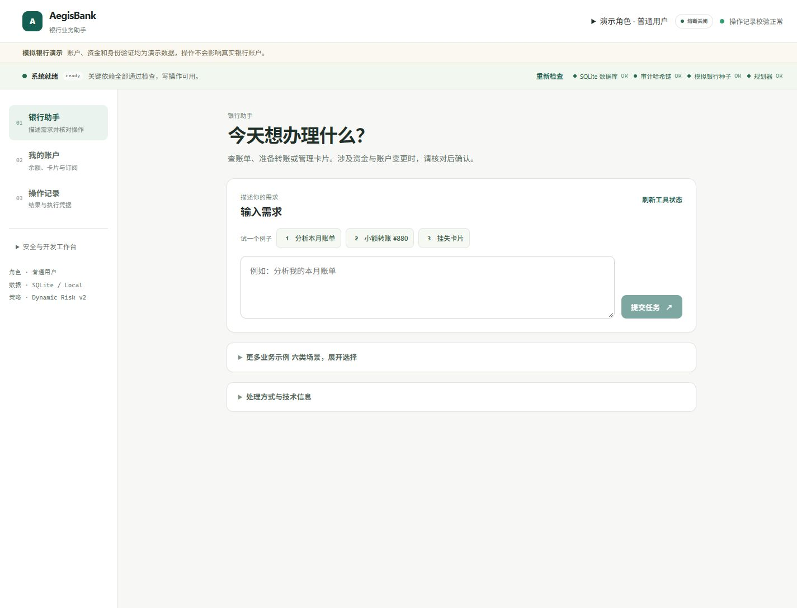
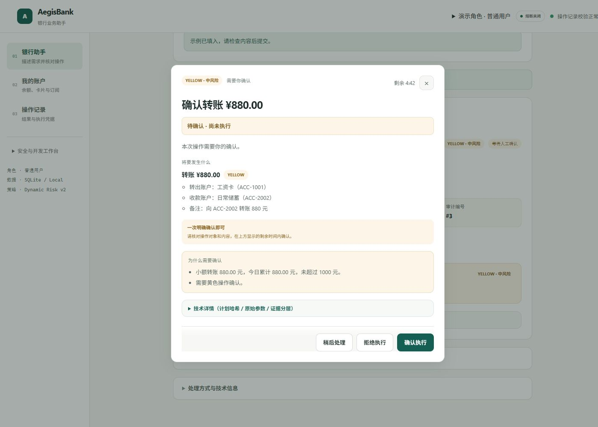
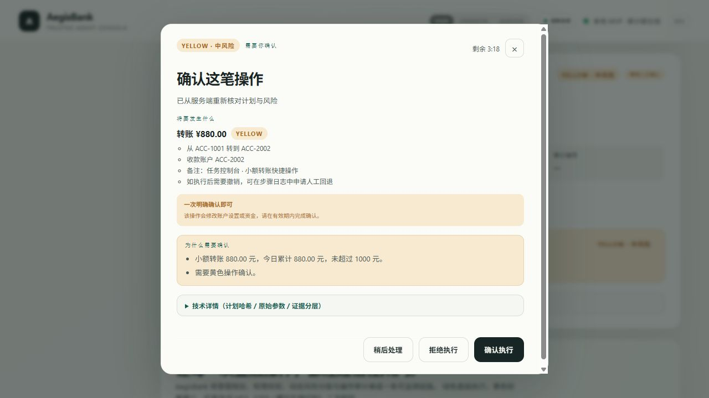
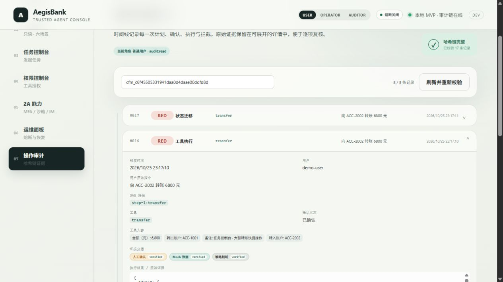

# AegisBank

> 2026-10-31 自动收尾：时区测试与 U1 安全评测口径补强，联系人确认绑定固定出账账户；本轮证据见[收尾记录](docs/CLOSURE-2026-10-31.md)，剩余见[人工参与清单](docs/CLOSURE-MANUAL-2026-10-31.md)。当前候选 Word/PDF/PPT 已更新，视频与正式提交仍待人工。

**用自然语言办理模拟银行业务，每一步都有计划、确认与审计。**

2026 深圳国际金融科技大赛参赛原型，由 0xChainAegis 团队维护。

[六类场景](#六类场景) · [安全设计](#安全设计) · [快速开始](#快速开始) · [团队协作](#团队协作) · [参赛材料](#参赛材料)





界面改造、真实联调结果及待后端核实的统计口径见 [10月27日银行助手记录](docs/FRONTEND-PRODUCT-2026-10-27.md)。

> **演示边界**：账户、卡片、账单、理财和交易均来自确定性的 Mock Bank Core，不连接真实银行、不产生真实资金变动。固定 OTP、模拟生物识别和角色请求头用于本地展示；理财数据与收益均为模拟。

## 它如何工作

用户表达需求，Agent 生成结构化计划，系统根据权限与风险决定执行方式。

```text
自然语言 → Planner → Plan Compiler → 动态风险 → 统一权限网关
         → 分级确认 / 演示 MFA → ToolExecutor → Mock Bank Core
         → 执行回执 + 证据分层 + SHA-256 审计哈希链
```

例如“分析我的账单并取消异常订阅”会生成两步 DAG。任务包含状态变更，因此整条任务先等待确认，确认后再依次执行账单查询与订阅取消。后续节点引用前序结果，避免猜测操作对象。

## 六类场景

- **智能转账**：按联系人、别名或手机号转账，支持 AA 拆分、定时与周期任务。
- **账单分析**：月度与年度报告、分类统计、异常交易及订阅涨价识别。
- **理财操作**：模拟产品与持仓查询、风险测评、申购和赎回。
- **卡片管理**：额度、每日交易限额、还款日、挂失/解挂及虚拟卡申请。
- **订阅 / 代扣**：扣费识别、续费提醒，以及确认后取消订阅。
- **跨场景联动**：账单分析后取消异常订阅，或查生日、锁预算、预约鲜花与蛋糕。

支持的示例指令：

```text
分析我的本月账单
向 ACC-2002 转账 880 元
解挂卡片 CARD-8821
买 1000 元稳健短债A
分析我的账单并取消异常订阅
帮我准备下个月妈妈的生日，预算 1000 元
给妈妈转钱（再回复「五百」；随后可回复「不是500，改成300」）
我刚才转了多少
```

六场景指已验证的代表链路，通用指代、自由组合和对话纠错仍有待完善。歧义金额与不支持的条件请求会转为澄清，P1 有界升级另见下节。详见 [NLP 现状](docs/NLP-ASSESSMENT-AND-PLAN-2026-10-25.md) 与 [NLP 待办](docs/NLP-BACKLOG.md)。

## NLP P1 有界语义升级（2026-10-28）

提供 `SemanticFrame/v1`、原文与槽位证据、当前用户实体验证、金额及上海业务日期规范化。补充完整表达回退门禁、槽位到工具参数绑定、局部否定和六场景受限口语；未知对象、条件、尾任务和冲突参数要求澄清。语义报告仍绑定计划哈希，模型不能授权或降级风险。

83条开发与反馈回归通过，不能作为自然语言准确率100%的证据。首次独立探针暴露覆盖缺口，已用于修复；正式人工保留集和真实模型效果仍未验收。通用多轮与自由组合仍待实现。详见 [P1补缺验收与边界](docs/NLP-P1-COMPLETION-2026-10-28.md)。

## U1 独立评测与有界补强（2026-10-30）

已冻结 304 条 AI 辅助静态金标，按 76 个表达家族隔离开发集与保留集，并提供原规则/新语义离线对照、完整计划参数与 DAG 判定、安全反例临时库快照及失败裁决记录。开发集完整计划语义为 156/156；独立保留集为 116/148（78.38%），未达到 95% 候选目标；两组新语义安全反例均为 0/48 业务误写。

真实模型对照、真实延迟和成本因未配置模型而为 `not_run`，正式人工复核仍为 `pending`；多轮指标属于 U2，不能将本报告解释为通用 NLP 已完成。详见 [U1 评测报告](docs/U1-NLP-EVALUATION-2026-10-30.md)。

## U2 最小多轮闭环（2026-10-30）

联系人转账支持一条受控多轮链路：`给妈妈转钱 → 五百 → 不是500，改成300 → 旧确认失效 → 重新确认 → 我刚才转了多少/转给谁`。每个会话只保留一个活动草稿，补槽只接受草稿声明的缺失金额，金额修订只允许 `changed_fields=[amount]`；修订后重新编译、更新 `plan_hash`、重新评级并生成新确认，旧确认执行返回 409。

草稿按 `session_id / draft_id / version` 定位，按当前用户隔离，默认 TTL 900 秒；历史查询只读取当前用户自己的 Mock Bank Core 真实转账流水，无记录时不编造。U3 习惯学习/推荐、U5 组合与条件规划、通用跨轮指代和长期记忆均未实施。实现范围、接口字段、稳定原因码与验收证据见 [U2 报告](docs/U2-CONVERSATION-2026-10-30.md)。

## U4 交付回归与收尾（2026-10-30）

`ConfirmationRequest` 的 `draft_id` / `draft_version` 已改为必须成对：只传其中一个会在进入确认业务逻辑前返回 HTTP 422，且不产生 pending 变更或转账；两者都不传仍兼容旧确认请求。独立回归 `test_u4_delivery_regression.py` 共 6 条，覆盖真实 SQLite 业务状态、补槽与金额修订、旧确认失效、跨用户、过期、幂等、TTL/长度边界与每用户终态清理。

当前完整验收为后端 652 项 pytest（36 个测试文件）、前端 144 项 Vitest（12 个测试文件）、组装器 18 项、六场景 30/30；工具目录 51 个、HTTP `/api` 路径 49 个，前端 39 个 `/api` 路径契约全部匹配。真实浏览器联调使用 Edge 156 headless CDP、Vite 5173 真实代理、FastAPI 8000 和全新 SQLite，从页面完成联系人转账并被查询回执；最终只有一笔 -30000 分转账，旧确认返回 `409 draft_version_conflict`，历史回执为妈妈 / 300.00 元。浏览器唯一 console error 是 `favicon.ico` 404。

该浏览器证据是 headless CDP 自动交互，不是人工物理鼠标键盘；底层仍是 Mock Bank Core，不是真实银行；生产身份、真实 MFA 和 OS 级沙箱仍未完成。U1 正式人工复核与真实模型对照、U3 习惯学习/推荐、U5 组合与条件规划也仍未完成。证据见 [U4 交付报告](docs/U4-DELIVERY-2026-10-30.md)。

## 安全设计

- **绿色自动执行**：余额、账单、持仓等只读查询。
- **黄色明确确认**：小额转账、取消订阅及部分账户设置。
- **红色确认 + 演示 MFA**：累计风险升级的转账、理财申购、挂失/解挂等操作。

风险由确定性规则判断，只能保持或上调。转账日累计包含本次金额，超过 1,000 元会升级为红色。

Planner 只生成候选计划。执行前统一校验 Schema、依赖、工具授权、角色能力与注入风险；确认绑定计划、参数、nonce 和有效期。幂等机制防止重复执行，失败可进入补偿、暂停或 `UNKNOWN` 人工对账流程。服务未就绪时禁用写操作。





SHA-256 哈希链用于检测日志改动，不等同于数字签名或独立存证。当前没有生产身份认证、真实 MFA、真实 IM 平台接入或 OS 级沙箱。详见 [安全说明](docs/SECURITY.md) 与 [系统架构](docs/ARCHITECTURE.md)。

## 快速开始

后端仍在 **Linux / WSL** 中运行，环境要求不变：Python 3.11+（含 venv/pip）和 Node.js（含 npm，版本 `^22.22.2 || ^24.15.0 || >=26.0.0`）必须安装在运行后端的 Linux / WSL 发行版中。只在 Windows 安装 Python/Node 不会满足 WSL 内的要求。首次运行需要联网；缺少 uv/pnpm 时会安装到项目的 `.runtime/.launcher-tools/`，无需全局安装或管理员权限。

### 作者本机：新开 PowerShell 或 CMD，直接复制这一行

**按当前终端选择下面一行；可从任意当前目录执行，无需先 `cd`。**

PowerShell（显式启动 WSL 进程并在当前窗口等待）：

```powershell
Start-Process -FilePath wsl.exe -ArgumentList '-d Ubuntu-24.04 --cd /home/lqz5885/aegisbank/dev/aegisbank --exec bash ./start.sh' -NoNewWindow -Wait
```

CMD（直接调用 WSL）：

```bat
wsl.exe -d Ubuntu-24.04 --cd /home/lqz5885/aegisbank/dev/aegisbank --exec bash ./start.sh
```

命令明确选择已有的 `Ubuntu-24.04` 及 Linux 开发主线。Windows 的 `D:\开发交流\mia03-ether\aegisbank智能体` 是冻结的历史副本，不能用它启动当前产品。上面这条绝对路径只适用于作者本机；其他电脑按下一节选择自己的发行版和仓库。

启动会在**当前终端持续输出**组装、依赖安装和就绪检查进度。出现 `已就绪，银行助手：http://127.0.0.1:5173/#/console` 后访问[银行助手](http://127.0.0.1:5173/#/console)，[API 文档](http://127.0.0.1:8000/docs)在 8000 端口。保持终端打开，按 **Ctrl+C** 同时停止本次前后端。打开 PowerShell 窗口或切换目录本身不代表服务已启动。

不自动打开浏览器时，PowerShell 使用：

```powershell
Start-Process -FilePath wsl.exe -ArgumentList '-d Ubuntu-24.04 --cd /home/lqz5885/aegisbank/dev/aegisbank --exec bash ./start.sh --no-browser' -NoNewWindow -Wait
```

CMD 使用：

```bat
wsl.exe -d Ubuntu-24.04 --cd /home/lqz5885/aegisbank/dev/aegisbank --exec bash ./start.sh --no-browser
```

### 其他 Windows 电脑：在已有 WSL 中首次克隆并启动

先查看自己的发行版名称。PowerShell 使用：

```powershell
Start-Process -FilePath wsl.exe -ArgumentList '-l -v' -NoNewWindow -Wait
```

CMD 使用：

```bat
wsl.exe -l -v
```

下面以已有 `Ubuntu-24.04` 为例；发行版名称不同时，替换 `-d` 后的名字。Python/Node 仍须满足上面的版本要求。这会在 WSL 用户主目录克隆源码并直接启动。PowerShell 使用：

```powershell
Start-Process -FilePath wsl.exe -ArgumentList '-d Ubuntu-24.04 --cd ~ --exec bash -lc "git clone https://github.com/0xChainAegis/aegisbank.git aegisbank && exec bash aegisbank/start.sh"' -NoNewWindow -Wait
```

CMD 使用：

```bat
wsl.exe -d Ubuntu-24.04 --cd ~ --exec bash -lc "git clone https://github.com/0xChainAegis/aegisbank.git aegisbank && exec bash aegisbank/start.sh"
```

已经克隆到 WSL 主目录下的 `aegisbank` 时，不要重复克隆。PowerShell 使用：

```powershell
Start-Process -FilePath wsl.exe -ArgumentList '-d Ubuntu-24.04 --cd ~/aegisbank --exec bash ./start.sh' -NoNewWindow -Wait
```

CMD 使用：

```bat
wsl.exe -d Ubuntu-24.04 --cd ~/aegisbank --exec bash ./start.sh
```

仓库在其他位置时，将 `--cd` 后的路径改为自己的 **Linux 绝对路径**。上述命令不会修改 WSL 默认发行版、系统执行策略或 Python/Node 版本。

### 已在当前仓库目录：可选脚本入口

当前目录必须是包含 `start.ps1`、`start.cmd`、`start.sh` 的**当前版本仓库根目录**。PowerShell 使用：

```powershell
powershell.exe -NoProfile -ExecutionPolicy Bypass -File .\start.ps1 -Distro Ubuntu-24.04
```

CMD 使用：

```bat
start.cmd -Distro Ubuntu-24.04
```

CMD 与 PowerShell 共用同一份 Windows 启动逻辑。支持用 `-Repo /Linux/绝对路径` 明确指定另一检出；WSL UNC 路径会解析路径内的发行版，并拒绝与 `-Distro` 冲突的选择。`-NoBrowser` 或 `--no-browser` 均可关闭自动打开浏览器。执行策略参数仅针对当前 PowerShell 子进程，不修改系统策略。

### Linux / WSL 终端

在仓库根目录运行：

```bash
bash start.sh
```

默认使用离线规则 Planner 和独立模拟库 `.runtime/backend/data/quickstart.db`，**无需模型密钥，重复启动保留数据**。所有金融数据来自 Mock Bank Core；写操作仍经过风险分级、确认/MFA 与审计，演示 OTP 为 `246810`。macOS 原生入口暂不在本轮验证范围。

### 没看到“已就绪”时

- 找不到 `start.ps1` / `start.cmd`：当前目录不是最新仓库根目录。作者本机直接使用上面的 WSL 绝对路径命令。
- 发行版不存在或找不到 `start.sh`：用 `wsl.exe -l -v` 核对发行版；核对 `--cd` 是否为该发行版内的 Linux 仓库路径。
- Python/Node 缺失或版本不符：检查所选 WSL 内的安装，Windows 的安装不参与后端执行。
- 端口占用或重复启动：先在原服务窗口按 Ctrl+C，再启动一次；入口不会终止或复用未知服务。
- 依赖安装失败或就绪超时：终端会打印失败原因和本次日志目录 `.runtime/launcher-logs/…`；未显示“已就绪”不能视为启动成功。

启动后可在另一个 PowerShell 或 CMD 中验证 Windows 能访问后端和前端：

```powershell
curl.exe --fail http://127.0.0.1:8000/api/health/ready
curl.exe --fail http://127.0.0.1:5173/api/health/ready
```

两项都应返回 `"status":"ready"`。高级开发、模型配置和手动启动见[贡献指南](CONTRIBUTING.md)与 [API 交接文档](docs/API-HANDOFF.md)。

## 团队协作

**源码在六个职责包中编辑，`.runtime/` 是生成目录，不作为开发主线。** 每次改动后重新组装，再运行测试与演示。

- [`fronted/`](fronted/)：React / TypeScript 前端，原始代码位于 `fronted/frontend/`；目录名沿用团队约定。
- [`backend/`](backend/)：FastAPI 入口、数据库、Mock Bank Core、依赖与运行脚本。
- [`agent/`](agent/)：DAG 调度、权限网关、执行器、风险、审计与信任层。
- [`NLP/`](NLP/)：意图识别、金额解析、规则/LLM Planner 与受限澄清。
- [`skills/`](skills/)：银行工具 SDK、工具注册及业务场景技能。
- [`plans/`](plans/)：计划契约、编译器及规划资料，涉及运行代码，不能作为纯文档删除。

各自开分支，通过 PR 合入 `main`。接口变更先对齐输入/输出，不同时直接改别人负责的文件；原库与组织库只保留一条开发主线。AI 生成的代码与材料同样由对应负责人验证，协作约定见 [贡献指南](CONTRIBUTING.md) 与 [团队工作流](docs/TEAM-WORKFLOW.md)。

## 验证记录

最新的一键启动实现与实测结果见[启动记录（2026-10-31）](docs/ONE-COMMAND-START-2026-10-31.md)，完整门禁状态见本次提交尾注。下表保留 U4 的历史输出。

### 历史验证基线（2026-10-30 U4 收尾）

| 检查项 | 当前实际输出 | 证据 |
|---|---:|---|
| 后端 pytest | **652 passed**（36 个测试文件；0 failed / 0 skipped / 0 xfail） | Lead 最终全量复跑；唯一 warning 为 Starlette/httpx 弃用警告 |
| U4 独立回归 | **6 passed** | [`test_u4_delivery_regression.py`](backend/backend/tests/test_u4_delivery_regression.py) |
| 前端 Vitest | **144 passed**（12 个测试文件） | Lead 最终复跑；jsdom/契约级测试 |
| 根组装器 unittest | **18 passed** | Lead 最终复跑 |
| 六场景检查 | **30/30 passed** | Lead 最终复跑 |
| 工具目录 | **51 个** | `/api/planner/info` |
| HTTP `/api` 路径 | **49 个** | backend OpenAPI |
| 前端 `/api` 路径契约 | **39 个全部存在** | 前端路径与 backend OpenAPI 对照 |

该次验证口径只代表上述已知用例通过，不代表生产安全认证。真实浏览器联调的边界、截图和原始证据见 [U4 交付报告](docs/U4-DELIVERY-2026-10-30.md)。U1 正式人工复核仍为 `pending`、真实模型对照仍为 `not_run`；U3/U5 未实施。

### 历史验证快照

- **2026-10-25（历史快照，非当前）**：后端 252 项 pytest、前端 73 项 Vitest、六场景 29/29、实际前端入口 15/15。范围与部署条件见 [前端修复及验收记录](docs/FRONTEND-REPAIR-2026-10-25.md)。
- **2026-10-28（历史快照，非当前）**：P1 补缺验收为后端 607 项、前端 133 项、组装器 18 项、六场景 30/30。见 [P1 补缺验收](docs/NLP-P1-COMPLETION-2026-10-28.md)。
- **2026-10-29（历史快照，非当前）**：F0 收尾验收为后端 631 项、前端 136 项、组装器 18 项、六场景 30/30。
- **2026-10-30 U2 收尾（历史快照，非当前）**：后端 646 项（35 个测试文件）、前端 144 项（12 个测试文件）、组装器 18 项、六场景 30/30、工具 51 个、HTTP 路径 49 个。U4 新增 6 条独立回归后当前后端为 652 项。
- **2026-10-30 U1 验收（历史快照，非当前）**：后端 640 项、前端 136 项、组装器 18 项、六场景 30/30；U1 独立评测边界见 [U1 报告](docs/U1-NLP-EVALUATION-2026-10-30.md)。

职责包组装测试单独计数。CI 先组装 `.runtime/`，再验证应用；整合后的结果以 [GitHub Actions](https://github.com/0xChainAegis/aegisbank/actions) 为准。测试覆盖已知用例，不代表生产安全认证或任意自然语言均能成功执行。

## 参赛材料

- [本轮提交材料索引](deliverables/current/README.md)：技术文档、安全自评的 Word / PDF，以及现有 14 页答辩 PPT。
- [文档索引](docs/README.md)：架构、业务场景、安全、NLP、验收与协作说明。
- [真实界面截图](docs/screenshots/README.md)：本轮验证图与历史页面记录。

演示视频成片和正式答辩时长核验仍待完成。提交截止为 **2026-11-02 18:00（中国标准时间）**。

## 来源与许可

原始银行原型来自 [LQZ5885/aegisbank](https://github.com/LQZ5885/aegisbank)，由组织仓库继续协作，保留原作者版权声明。AegisAgent 的设计参考范围见 [来源说明](docs/UPSTREAM-NOTES.md)，第三方资料见 [参考资料索引](docs/reference/README.md)。本项目采用 [MIT License](LICENSE)。

欢迎通过 [Issue](https://github.com/0xChainAegis/aegisbank/issues) 提供复现步骤，或通过 [Pull Request](https://github.com/0xChainAegis/aegisbank/pulls) 改进项目。
