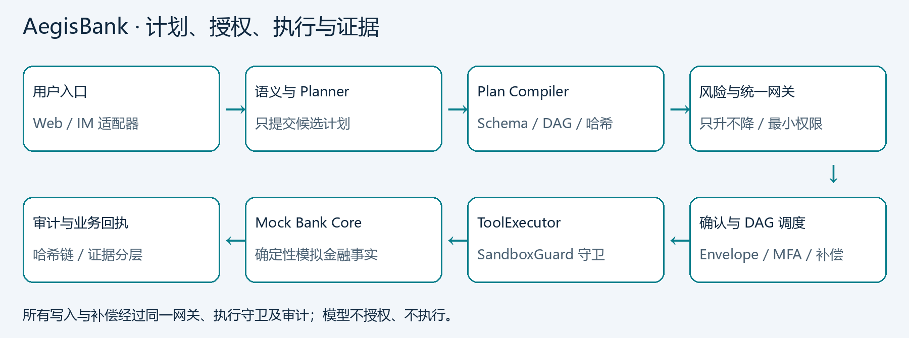

# AegisBank 技术文档

> 2026-10-31 收尾候选版｜仓库：https://github.com/0xChainAegis/aegisbank
> 代码与实测证据以[收尾执行记录](../docs/CLOSURE-2026-10-31.md)为准；人工验收与真实模型对照另列待办。

## 1. 目标与范围

用自然语言办理模拟银行业务，使计划可核对、敏感执行需确认、失败可接管、结果有证据。六类代表场景为转账、账单、理财、卡片、订阅与跨场景联动；不等同于任意表达和自由组合均受支持。

金融事实只来自 SQLite Mock Bank Core，不连接真实银行或支付网络。默认规则 Planner 离线可用；LLM 只生成候选，不执行工具或决定授权。

## 2. 系统架构

数据流：用户输入 → 有界语义/Planner → Plan Compiler → 动态风险 → 统一网关 → ActionEnvelope/确认/MFA → DAG 调度 → ToolExecutor/SandboxGuard → Mock Bank Core → 回执与审计。

| 源码职责包 | 维护内容 |
|---|---|
| fronted/frontend | React/TypeScript 银行助手、账户、记录与安全工作台 |
| backend/backend | FastAPI 装配、SQLite、Mock Bank Core 与请求模型 |
| NLP/backend | 金额/上海业务日期规范化、规则/LLM Planner、有界语义 |
| plans/backend | 计划契约、DAG 编译与 plan_hash |
| agent/backend | 风险、网关、调度、确认、MFA、补偿、沙箱与审计 |
| skills/backend | 银行工具与自动发现的场景模块 |

根目录运行 `python3 scripts/assemble.py` 组装至 `.runtime/`；生成目录不作为第二份源码维护。

## 3. 核心算法与机制

1. 语义处理：规范化中文金额和 Asia/Shanghai 业务日期；SemanticFrame 携带原文证据、受控实体及缺失/歧义说明。未知对象、多义金额、不支持的条件或多动作返回澄清，不能静默丢步骤并执行剩余动作。
2. 计划编译：验证工具目录、输入 Schema、步骤 ID 和依赖，检测环并拓扑排序；规范化计划后计算 SHA-256 plan_hash。模型候选须经字段白名单和冲突校验。
3. 动态风险：最终等级取工具基线与确定性规则的最大值，模型不能降级风险。日累计转账包含本次；≤1000 元的小额转账需确认，>1000 元升级红色；挂失、理财申购等按工具基线要求强验证。
4. 统一网关：注入扫描、AuthzService 能力、工具授权和风险分级共同决定 allow/confirm/deny。撤权后旧确认不能执行；前端不维护另一套权限矩阵。
5. 执行绑定：确认绑定用户、计划与参数哈希、风险、权限、nonce 和有效期，执行前重新核验；不一致返回 409。Idempotency-Key 重试复用首次结果，防止第二次扣款。
6. 执行守卫：所有工具及补偿经 ToolExecutor、SandboxGuard 与审计，约束网络、超时、入出体积和工具白名单。线程超时不等于 OS 强制终止。
7. 恢复与审计：DAG 支持步骤间暂停/恢复、受控逆序补偿；不可逆动作不伪装可回滚。UNKNOWN 不自动重试，进入人工核对。SHA-256 审计链记录指令、路径、参数、确认和结果，证据按 source/verified/verification_kind 分层。

## 4. 最小多轮转账

“给妈妈转钱 → 五百 → 改成三百 → 旧确认失效 → 重新确认 → 我刚才转了多少/转给谁”。

每个会话只有一个活动草稿，按用户隔离，以 session_id/draft_id/version 定位；补槽只接受缺失金额，修订只允许未执行草稿金额。重新编译产生新哈希、新 nonce、新风险评估与新确认，旧确认返回 409。联系人转账既有固定出账账户 ACC-1001 通过受限 Schema 默认值进入编译参数及哈希，确认摘要直接显示该服务端事实，不能改用其他账户。历史查询读取本人实际 Mock 流水，无记录不编造。

## 5. 验证与效果边界

自动验证包括后端/前端/组装器测试、六场景脚本、API 契约、lint/build、独立演示库启动与审计，以及真实 Chromium/Vite/FastAPI/SQLite 浏览器链路。当前结果及原始日志统一见收尾记录，避免在多处复制易漂移数字。

离线评测保持开发与保留集表达家族隔离；报告完整计划、关键参数、澄清、条件和安全误写。人工金标复核仍 pending，真实模型对照按用户选择暂缓；离线成绩不能冒充真实模型成绩。390px 自动浏览器检查也不能替代人工手机、物理键盘和屏幕阅读器验收。

## 6. 已知限制

固定 OTP、模拟生物识别、角色请求头仅用于演示；没有生产身份、真实 MFA、真实 IM 平台或 OS 级隔离。幂等/nonce 长期清理、分布式一致性、WORM 审计及高可用仍属生产化 backlog。U3 个性化与 U5 通用组合/条件规划未实施。

部署、复现和风险分别见同目录的部署说明、测试与复现、安全自评报告。
