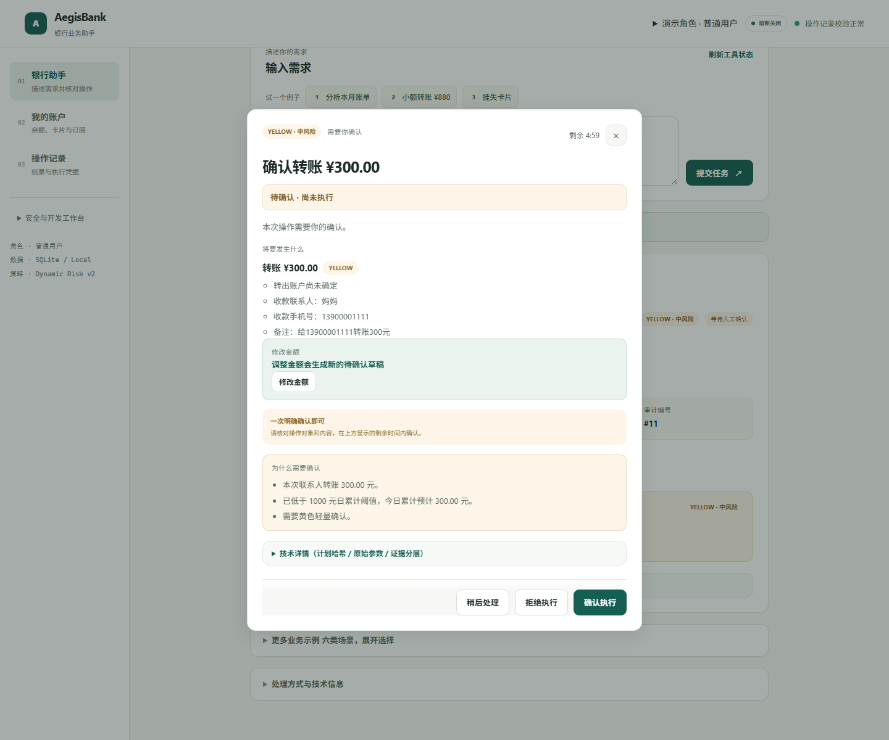
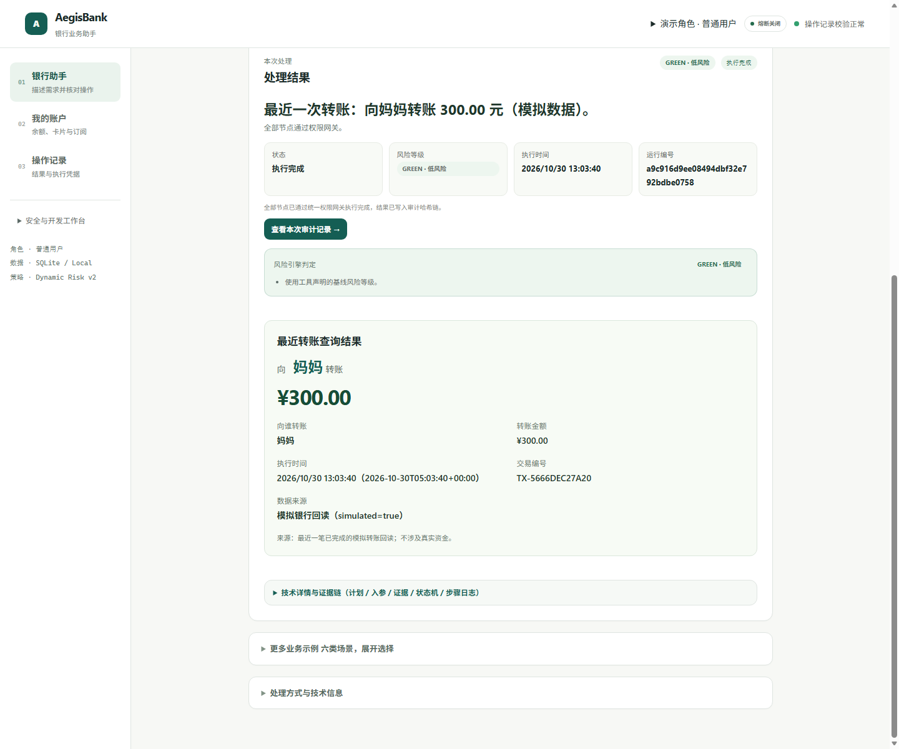

# U4：交付回归与文档收尾报告（2026-10-30，已完成 ✅）

> 结论：U4 本轮只收尾联系人转账最小多轮闭环的交付回归、真实前后端浏览器联调、API 冻结与文档一致性检查，并已完成。
>
> 该结论不表示 U1 已整体关闭，也不表示 U3、U5、通用多轮、真实银行、真实身份、生产 MFA 或 OS 级沙箱已经完成。U1 正式人工复核仍为 `pending`，真实模型对照仍为 `not_run`。
>
> 证据基线：当前 WSL 开发工作树，仓库开发基线为 `309e43d0ee3a1127f0ae77dd15775c4604df4583`，另含本轮未提交的 schema 修复、独立回归测试与证据文件。具体捕获时点以各 fixture 内 `captured_at` / `generated_at` 为准。

## 1. 实际交付范围

本轮围绕一条受控主链路收尾：

```text
给妈妈转钱
  → 五百（补齐当前草稿缺失金额）
  → 不是500，改成300（只修改未执行草稿金额）
  → 旧确认失效
  → 重新确认
  → 我刚才转了多少 / 我刚才转给谁
```

U4 新增或补齐的可复核内容：

- `ConfirmationRequest` 的 `draft_id` / `draft_version` 成对校验修复，以及 HTTP 422 零执行回归；
- 6 条独立交付回归，覆盖真实 SQLite 业务状态、幂等、跨用户、过期、终态清理、长度边界与成对字段校验；
- 一次真实浏览器 UI → Vite 代理 → FastAPI → 全新 SQLite 的联调；
- U4 API 冻结样例与真实联调原始证据；
- README、ROADMAP、MASTER-PLAN、API 交接、交付说明与任务清单的当前口径更新。

明确不在本轮范围：

- U1 正式人工金标复核、真实模型对照、真实延迟与成本报告；
- U3 习惯学习、个性化推荐、偏好中心；
- U5 多意图组合、条件规划、通用跨轮指代与长期记忆；
- 真实银行接入、真实资金、生产身份认证、生产 MFA、OS 级沙箱、分布式幂等。

## 2. Schema 修复与独立回归矩阵

### 2.1 `ConfirmationRequest` 成对字段校验

实现位于 `backend/backend/aegisbank_api/schemas.py`。当前请求模型规则为：

| `draft_id` | `draft_version` | 结果 |
|---|---|---|
| 都未提供 | 都未提供 | 兼容旧确认请求，继续进入业务上下文检查 |
| 提供 | 提供且为 `1..1_000_000` | 进入业务上下文检查 |
| 只提供 `draft_id` | 缺失 | Pydantic 返回 HTTP 422，不进入确认 executor |
| 缺失 | 只提供 `draft_version` | Pydantic 返回 HTTP 422，不进入确认 executor |

冻结证据见 [`fixtures/u4-api-freeze-2026-10-30.json`](fixtures/u4-api-freeze-2026-10-30.json) 的 `pair_validation`：两种单向缺字段均由 Pydantic 拒绝；拒绝后原 pending action 仍为 `pending`、`result_json` 为空，转账记录数为 0。

### 2.2 独立 U4 回归

新增 [`backend/backend/tests/test_u4_delivery_regression.py`](../backend/backend/tests/test_u4_delivery_regression.py)，共 6 条测试，独立检查 `agent_drafts`、`pending_actions`、`bank_transactions` 与 `audit_log` 的持久化状态，不替代也不弱化既有断言。

| 测试 | 覆盖矩阵 | 关键断言 |
|---|---|---|
| `test_u4_real_delivery_chain_is_idempotent_and_audited` | 补槽、修订、旧确认失效、重新确认、幂等、历史回读、审计 | 旧 action 为 `superseded` 且无执行结果；新 action 完成后仅一笔 `-30000` 分转账；草稿终态为 `completed`；用户 B 无本人转账回读；审计链可校验 |
| `test_u4_invalid_fill_and_amendment_preserve_pending_state_and_zero_writes` | 非法补充、非法修订、多收款人/多金额/附加动作 | 返回 `unsupported_amendment` 或 `missing_amount`；草稿版本、pending action、`result_json` 均不变化；无新增 pending 或转账 |
| `test_u4_cross_user_draft_and_confirmation_are_invisible_and_write_nothing` | 跨用户补槽与确认 | 两次请求均返回 `context_expired`；草稿、pending、流水、审计计数均不变；所有者随后仍可正常完成 |
| `test_u4_expired_draft_is_invalidated_on_read_and_removed_by_cleanup` | 读取过期与创建时清理 | 过期读取返回 `context_expired` 并将草稿置为 `expired`；无 pending/流水；新建草稿触发清理后旧行消失 |
| `test_u4_terminal_cleanup_is_per_user_and_keeps_newest_bounded_rows` | 每用户终态上限与清理隔离 | 终态按用户独立保留，验证时把上限设为 2，只保留最新 2 条；活动草稿与另一用户记录不被误删 |
| `test_u4_request_bounds_and_draft_pair_validation_return_422_without_writes` | 请求长度、版本范围、成对字段与零写入 | `instruction` 2000 字符可用、2001 拒绝；`session_id` / `draft_id` 64 字符可用、65 拒绝；`draft_version` 为 0 / 超过 1,000,000 拒绝；确认请求单向缺字段 422；业务零写入 |

## 3. 当前精确验证数字

以下数字来自 Lead 在 2026-10-30 对当前工作树/最终测试文件完成的实际复跑；不是沿用 2026-10-25 或 U2 收尾时的旧数字。

| 检查项 | 当前实际输出 | 口径 |
|---|---:|---|
| 后端 pytest | **652 passed**，36 个测试文件 | 0 failed / 0 skipped / 0 xfail；唯一 warning 为 Starlette/httpx 弃用警告 |
| 其中 U4 独立回归 | **6 passed** | `test_u4_delivery_regression.py` |
| 前端 Vitest | **144 passed**，12 个测试文件 | jsdom/契约级测试，不是浏览器 E2E |
| 根组装器 unittest | **18 passed** | `tests/` 组装器检查 |
| 六场景检查 | **30/30 passed** | `scripts/scenario-check.py` |
| 工具目录 | **51 个** | `/api/planner/info` |
| HTTP `/api` 路径 | **49 个** | backend OpenAPI paths |
| 前端 `/api` 路径契约 | **39 个全部存在** | 前端调用路径均在 backend OpenAPI 中匹配 |

> 不要把前端 144 条 Vitest 或 jsdom 交互测试解释为真实浏览器联调。真实浏览器证据只来自下一节所述 Edge headless CDP 运行。

本次文档收尾补充实测：`cd .runtime/backend && uv run ruff check .` 返回 `All checks passed!`；`cd .runtime/frontend && pnpm build` 执行 `tsc --noEmit && vite build`，54 个模块转换完成并构建成功。该结果不等同于完整生产发布门禁。

复现入口：

```bash
# 在仓库根目录执行
python3 scripts/assemble.py
(cd .runtime/backend && uv run pytest -q)
(cd .runtime/frontend && pnpm test -- --run)
(cd .runtime/backend && uv run python ../scripts/scenario-check.py)
python3 -m unittest discover -s tests -q
```

## 4. 真实前后端浏览器联调

### 4.1 真实链路

| 项 | 实测值 |
|---|---|
| 浏览器 | Microsoft Edge `Edg/156.0.4314.50`，Windows 版，`--headless=new` |
| 自动化 | Chrome DevTools Protocol 1.3；`Runtime.evaluate` 触发 Chromium 中的 DOM 输入与 `HTMLElement.click()` |
| 前端 | Vite 7 dev server，`127.0.0.1:5173`，真实 `/api` 代理 |
| 后端 | FastAPI/uvicorn `aegisbank_api.main:app`，`127.0.0.1:8000` |
| 数据库 | 本次运行新建的 `/tmp/u4-browser-e2e-*.db`，不是历史库 |
| 是否 jsdom / API Mock | **否**；真实浏览器、真实 Vite 代理、真实 FastAPI、全新 SQLite |
| 证据 | [`fixtures/u4-real-integration-2026-10-30.json`](fixtures/u4-real-integration-2026-10-30.json) |

复现命令（脚本会重新组装当前六模块源码；前提是 `.runtime` 依赖已安装）：

```bash
node scripts/u4-browser-e2e.mjs
```

脚本会在 8000/5173 空闲时自行启动 FastAPI、Vite 与 Edge headless，完成后关闭服务并刷新本页证据文件与两张截图。

### 4.2 UI 点击链与结果

实际通过 UI 完成 13 步输入/点击：首轮「给妈妈转钱」、补充「五百」、在确认弹窗中点击「修改金额」并输入 300、提交修改、确认执行新的 300 元转账，最后查询「我刚才转了多少」和「我刚才转给谁」。

结果：

- 首轮显示「请补充金额」、草稿版本 `v1`、缺失槽位 `amount`、`missing_amount`；
- 补充 500 后出现黄色确认弹窗，显示「尚未执行」；
- 修改金额后出现新的 300 元确认，确认前旧 500 元 action 不产生转账；
- 在修改金额之后，通过真实 Vite 代理直接重放旧确认，返回 **HTTP 409**、`detail.code=draft_version_conflict`；该重放是浏览器外部的真实 HTTP 调用，不是把 jsdom/Mock 当作浏览器点击；
- 最终数据库只有一笔 `category=transfer`、`amount_cents=-30000`、`status=posted` 的记录，属于 `demo-user`；没有第二笔转账；
- 历史回执显示向妈妈转账 300.00 元，包含交易时间、交易编号和 `simulated=true`；
- 旧 pending action 为 `superseded` / `EXPIRED` 且无 `result_json`，新 pending action 为 `completed`；
- 浏览器控制台唯一 error 是 `http://127.0.0.1:5173/favicon.ico` 的 404；没有业务 API 或页面脚本 error。

### 4.3 截图

两张截图均为 1440×1200：





截图与 JSON 均为本轮真实运行证据；本报告不硬编码本次易变的 action/transaction ID，原始值统一在证据 JSON 中审计。重新运行脚本会刷新 fixture 与截图，不应把旧 ID 写入文档。

### 4.4 联调边界

- 这是 **headless Edge + CDP**，DOM 事件真实经过 Chromium，但不是人工物理鼠标/键盘操作；
- 页面连接的是真实本地 FastAPI 与全新 SQLite，但底层仍是 **Mock Bank Core**，不是真实银行或支付网络；
- 300 元转账为黄色轻确认，不需要 OTP；固定 OTP、模拟生物识别和 `X-Aegis-Role` 都只是演示机制；
- 证据中的日志和 SQLite 数据库位于 `/tmp`，不随仓库提交。

## 5. API 冻结

冻结文件：[`fixtures/u4-api-freeze-2026-10-30.json`](fixtures/u4-api-freeze-2026-10-30.json)，schema 为 `aegisbank-u4-api-freeze/v1`，由真实 TestClient 运行捕获关键字段；它不是手写 Mock 响应。

### 5.1 可选请求字段

`POST /api/agent/run`：

```json
{
  "instruction": "五百",
  "user_id": "demo-user",
  "session_id": "<session_id>",
  "draft_id": "<draft_id>",
  "draft_version": 1
}
```

`POST /api/confirmations/{action_id}`：

```json
{
  "approved": true,
  "user_id": "demo-user",
  "session_id": "<session_id>",
  "draft_id": "<draft_id>",
  "draft_version": 3
}
```

`draft_id` 与 `draft_version` 必须成对；两者都省略时保留旧客户端兼容路径。单向缺字段在进入业务 handler 前返回 HTTP 422。

### 5.2 稳定错误码

| code | HTTP | 含义 |
|---|---:|---|
| `missing_amount` | 200 / 422 | 首轮联系人转账缺金额；或补充金额不可解析/非法 |
| `context_expired` | 409 | 草稿不存在、跨用户、会话不匹配、过期或已结束 |
| `unsupported_amendment` | 409 | 补充/修订包含金额以外的收款人、动作、条件或多金额 |
| `draft_version_conflict` | 409 | 版本过期、并发冲突、旧确认被替代或确认 ID 与草稿不匹配 |

冻结样例包含 12 个交互（首轮、补槽、修订、旧确认冲突、重新确认、历史金额/对象、两种单向缺字段等）及最终业务状态：一笔 `-30000` 分转账、旧 action `superseded`、新 action `completed`、审计链 `valid=true`。具体请求/响应形状与错误码见 [API 交接文档](API-HANDOFF.md) 的 U4 增量。

## 6. TTL、长度与清理复核

| 项目 | 实现/默认值 | U4 回归证据 |
|---|---|---|
| 草稿 TTL | 默认 900 秒，可由 `AEGIS_CONVERSATION_DRAFT_TTL_SECONDS` 配置 | 人工将 `expires_at` 置为过去时间后读取，返回 `context_expired`；草稿状态变 `expired`，pending=0、流水=0 |
| 读时过期 | 读取时发现过期立即失效 | 过期草稿仍保留到下次清理触发点，但不再可补槽或执行 |
| 创建时清理 | 新建草稿时清理过期行 | 同一 session 重新发起后旧 draft 行被删除，只保留新活动草稿 |
| 每用户终态上限 | 默认最多保留 20 个终态草稿 | 测试临时设置为 2，验证仅保留最新 2 条；活动草稿保留；另一用户条目完全不受影响 |
| `instruction` | 1–2000 字符 | 2000 字符成功，2001 字符 HTTP 422 |
| `session_id` / `draft_id` | 1–64 字符 | 64 字符通过 schema，65 字符 HTTP 422 |
| `draft_version` | 1–1,000,000 | 0 或 1,000,001 返回 HTTP 422 |
| `user_id` | 1–64 字符 | 65 字符 HTTP 422 |

清理验证是有界行为验证，不是生产级 TTL 调度器或跨设备会话服务：本轮没有新增后台定时清理器，也没有分布式锁或跨节点一致性。

## 7. 证据索引

| 证据 | 路径 |
|---|---|
| U4 独立回归测试 | [`../backend/backend/tests/test_u4_delivery_regression.py`](../backend/backend/tests/test_u4_delivery_regression.py) |
| API 冻结 | [`fixtures/u4-api-freeze-2026-10-30.json`](fixtures/u4-api-freeze-2026-10-30.json) |
| 真实浏览器联调 JSON | [`fixtures/u4-real-integration-2026-10-30.json`](fixtures/u4-real-integration-2026-10-30.json) |
| 修改后确认截图 | [`fixtures/u4-real-integration-2026-10-30-amended-confirmation.png`](fixtures/u4-real-integration-2026-10-30-amended-confirmation.png) |
| 最终历史回执截图 | [`fixtures/u4-real-integration-2026-10-30-final-history.png`](fixtures/u4-real-integration-2026-10-30-final-history.png) |
| 可复现浏览器脚本 | [`../scripts/u4-browser-e2e.mjs`](../scripts/u4-browser-e2e.mjs) |
| 需求依据 | [`next-steps/AegisBank-问题修复与升级计划.md`](next-steps/AegisBank-问题修复与升级计划.md) §7.1 |
| U2 最小多轮报告 | [`U2-CONVERSATION-2026-10-30.md`](U2-CONVERSATION-2026-10-30.md) |

## 8. 已知限制与未完成边界

- **U1 未整体完成**：保留集完整计划语义为 116/148（78.38%），未达到 95% 候选目标；`human_review=pending`、`real_model=not_run`，不能写作已完成。
- **U3 未实施**：没有习惯学习、推荐排序、偏好存储或偏好中心。
- **U5 未实施**：没有多意图 DAG、条件表达式、任意组合规划或通用跨轮指代。
- **真实银行未接入**：账户、联系人、卡片、账单、理财与交易均来自 Mock Bank Core；不产生真实资金变动。
- **生产安全未完成**：无生产身份认证、真实 MFA、OS 级沙箱、WORM 审计、分布式幂等或跨设备会话同步。
- **浏览器证据边界**：Edge headless CDP 的 DOM 点击不是人工物理输入；只覆盖本次联系人转账主链路和两条历史查询，不覆盖全部六场景的浏览器自动化。
- **测试边界**：652 条后端测试只证明当前已知用例通过，不等于生产安全认证或任意自然语言都能成功。

## 9. 收尾核对

- `git diff --check`：通过，无空白错误；
- Markdown 相对链接与图片路径：根 README、`docs/**`、`deliverables/**` 共检查 254 条，缺失 0 条；代码围栏成对；
- U4 最终数字占位符：0 处残留；`187/53/29`、`252/73` 等旧数字未被当作当前基线；
- 旧数字口径：187/53/29 与 252/73 在任一被更新文档中均只作为带日期的历史快照出现，不作为当前基线；
- 文档收尾只修改 `docs/**`、`README.md`、`deliverables/**`；U4 同一交付提交还包含 schema 修复、独立测试、E2E 脚本与 fixture，分别由对应任务验证。
