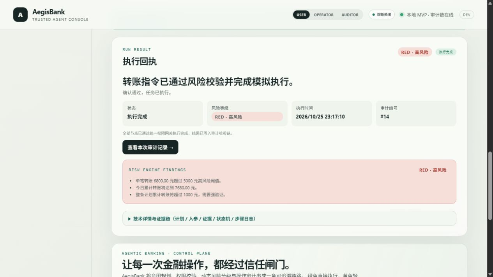

# AegisBank 真实界面截图

本目录保存从实际运行的 AegisBank 控制台截取的界面。图片与文档一同提交到 Git，根 README 使用标准 Markdown 相对路径，避免依赖本机路径或其他分支的文件。

## 本轮验证图（2026-10-25）

- [执行回执](receipt-verified-2026-10-25.jpg)：红色模拟转账经演示 MFA 后执行，展示风险原因、回执与审计编号。
- [刷新后恢复确认](confirmation-recovery-2026-10-25.jpg)：向服务端核对原任务，恢复黄色确认流程。
- [审计与证据](audit-verified-2026-10-25.jpg)：确认、执行、模拟数据证据与哈希链记录。

## 原有页面记录

以下 PNG 保留原有界面快照，界面布局可能早于本轮修复，不作为全部新交互均已验证的依据。

- [银行概览](banking-overview.png)
- [任务控制台](task-console.png)
- [确认 / 演示 MFA](confirmation-modal.png)
- [工具权限](permissions.png)
- [操作审计](audit.png)
- [移动端概览](banking-overview-mobile.png)
- [产品介绍页](product-overview.png)

## 更新与检查

1. 从仓库根目录执行 `python3 scripts/assemble.py`，再在 `.runtime/` 内启动服务，使用默认 Mock 数据截图。
2. 保留关键标题、风险与执行状态，移除真实个人信息和无关桌面内容。截图必须来自实际界面，不能以设计稿或合成图代替。
3. 新图片使用明确文件名，更新引用后将图片与 README 一起提交；文件名大小写与扩展名必须一致。
4. 本目录内链接使用文件名，根 README 使用 `docs/screenshots/文件名`；不要使用 Windows 本机路径。
5. 在目标 PR 分支和合入后的 `main` 分别检查图片可访问性。相对链接在当前分支取文件，其他分支存在图片不代表 `main` 已包含它。
